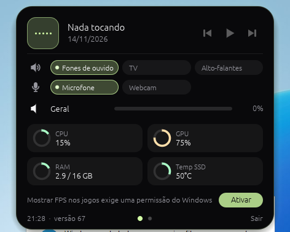
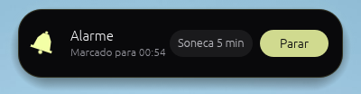

<div align="center">

# Islandbar

**Uma "Dynamic Island" para o Windows, leve e animada.**

Fica no topo da tela e se abre num painel com mixer de volume, mídia, troca de
fone/caixa de som, alarme e o uso do PC. Nos jogos, mostra FPS, CPU, GPU e RAM.

[](https://github.com/Igorms27/Islandbar/actions/workflows/build.yml)
[](https://github.com/Igorms27/Islandbar/releases/latest)
[](LICENSE)


**[⬇ Baixar o islandbar.exe](https://github.com/Igorms27/Islandbar/releases/latest/download/islandbar.exe)**


</div>

<p align="center">
  
  &nbsp;
  
</p>

## Sumário

- [Recursos](#recursos)
- [Instalação](#instalação)
- [Como usar](#como-usar)
- [Leve de verdade](#leve-de-verdade)
- [Solução de problemas](#solução-de-problemas)
- [Para desenvolvedores](#para-desenvolvedores)
- [Licença](#licença)

## Recursos

- **Pílula no topo** com relógio, música atual e barrinhas que dançam com o som.
- **Pets**: troque as barrinhas por um fantasminha ou um robozinho. Eles piscam, olham para os lados
  e abrem a boca cantando quando sai som, mesmo com o volume baixo. A escolha fica no cartão inicial. Sem música, mostra
  o uso de CPU, GPU e RAM.
- **Mixer**: volume geral e de cada aplicativo, com medidor de áudio ao vivo dentro de cada slider.
  Clique no ícone para deixar no mudo.
- **Saída de som e microfone**: um botão para cada saída (fone, TV, caixa de som) e para cada
  microfone. Um clique troca o que o Windows usa para música, jogos e chamadas.
- **Mídia**: título, artista e os botões anterior / tocar-pausar / próxima. Funciona com Spotify,
  navegadores e qualquer app que apareça no controle de mídia do Windows.
- **Alarme**: "toca daqui a X horas/minutos", com setinhas, atalhos ou digitando o número. Toca
  mesmo com a ilha fechada: na hora, o Windows abre a ilha sozinho (por uma tarefa do Agendador de
  Tarefas, "Islandbar - alarme", que some depois).
  Na hora, a ilha mostra um aviso com bip de despertador e os botões Soneca e Parar.
- **Aviso de volume**: ao usar as teclas de volume do teclado, a ilha se estica e mostra o nível.
- **Monitor do sistema**: CPU, GPU, RAM e temperatura, sem instalar driver. No cartão inicial você
  escolhe o sensor da temperatura (placa de vídeo, placa-mãe, disco ou automático) e quais números
  aparecem na ilha fechada e no modo jogo.
- **Modo jogo**: com um jogo em tela cheia, uma pílula ao lado da ilha mostra FPS, CPU, GPU e RAM.
  Navegadores e players de vídeo em tela cheia não contam como jogo.
- **Iniciar com o Windows** (opcional) e **atualização automática**.

<p align="center">
  
  <br>
  
</p>

## Instalação

Não precisa instalar nada além do próprio programa.

1. Baixe o **[islandbar.exe](https://github.com/Igorms27/Islandbar/releases/latest/download/islandbar.exe)**
   da versão mais recente.
2. Coloque o arquivo numa pasta sua (ex.: `Documentos\Islandbar`) e abra.
3. Na primeira vez, um cartão pergunta se a ilha deve abrir junto com o Windows.

> [!NOTE]
> O Windows pode mostrar o aviso "O Windows protegeu o computador" (SmartScreen), porque o
> executável não tem uma assinatura digital paga. Clique em **Mais informações → Executar assim mesmo**.

**Atualizações:** a ilha confere a cada 2 minutos se saiu uma versão nova. Se saiu, ela baixa, troca o
executável e reinicia sozinha quando estiver recolhida. Durante um jogo, ou com o alarme tocando, ela
espera. Um alarme marcado continua contando depois de reiniciar. A versão atual aparece no rodapé do painel. As notas de cada versão estão em
[Releases](https://github.com/Igorms27/Islandbar/releases).

## Como usar

| Para… | Faça |
| --- | --- |
| Abrir o painel | Clique na ilha. Ele fecha sozinho quando o mouse sai. |
| Mudar de página (Som ↔ Alarme) | Arraste o painel para o lado, use a rodinha lateral ou clique nas bolinhas do rodapé. |
| Trocar fone / TV / microfone | Página Som: clique no botão do dispositivo. |
| Marcar um alarme | Página Alarme: setinhas, atalhos (+5 min, +15 min…) ou clique no número e digite. **Enter** inicia. |
| Tirar a ilha da frente | Com o mouse em cima dela, aperte **Ctrl**. Ela some e os cliques passam para o que está atrás (dá para soltar o Ctrl e clicar normalmente). Volta quando o mouse sai. |
| Medir o FPS nos jogos | Na primeira vez, clique em **Ativar** no painel. O Windows pede confirmação de administrador uma vez, e passa a valer depois de sair e entrar na conta. |
| Fechar a ilha | Abra o painel e clique em **Sair**. Um alarme marcado continua valendo: na hora, o Windows abre a ilha e ele toca. Para desistir dele, cancele na página Alarme antes de sair. |
| Ligar/desligar o início com o Windows | Abra o `islandbar.exe` de novo: o cartão aparece outra vez. |
| Escolher o pet, os números da ilha e a temperatura | Também no cartão inicial (abra o `islandbar.exe` de novo). Cada opção de temperatura mostra o valor de agora; "n/d" quer dizer que o PC não tem aquele sensor. |

## Leve de verdade

A ilha foi feita para não pesar no PC nem roubar desempenho dos jogos.

- **Parada, ela dorme**: só é redesenhada quando algo na tela muda, cerca de 1 vez por segundo,
  com uso de CPU perto de zero.
- **Com som tocando**, as barrinhas animam a 30 quadros por segundo. Abrir, fechar e o painel aberto
  usam a taxa do monitor, para ficarem lisos.
- **Com um pet**, parada ela acorda só durante os gestos (menos de 1 segundo, a cada poucos segundos).
  As barrinhas continuam sendo a opção mais leve.
- **No modo jogo ela fica quieta**: não dança com o som, o pet não faz gestos e só atualiza os números,
  1 vez por segundo.
- **Só lê o que está na tela**: o volume de cada app, a temperatura e a lista de dispositivos só são
  consultados com o painel aberto.
- **Memória**: 30 segundos depois do último uso, ela devolve ao Windows a memória que ficou parada.

Para medir no seu PC, abra pelo terminal com `ISLANDBAR_DEBUG_PERF=1` e o stderr indo para um arquivo
(`islandbar.exe 2> perf.txt`). A cada 5 segundos ela anota quadros por segundo, uso de CPU e memória.

## Solução de problemas

<details>
<summary><b>A ilha some atrás de um jogo em tela cheia</b></summary>

A ilha volta para a frente sozinha mesmo quando o jogo se marca como "sempre no topo". Duas exceções:

- **Tela cheia exclusiva**: nesse modo o Windows não mostra nenhuma outra janela. Use o modo
  "janela sem bordas" (borderless) nas opções de vídeo do jogo.
- **Jogos Vulkan/OpenGL em placa NVIDIA** (ex.: Savage Wind Recomp): mesmo sem bordas, o driver pode
  mandar a imagem direto para o monitor. Para resolver, vá no Painel de Controle NVIDIA →
  **Gerenciar as configurações 3D** → **Configurações de programa**, adicione o `.exe` do jogo e mude
  **Método de apresentação Vulkan/OpenGL** para **Preferir em camadas na cadeia de troca DXGI**
  (em inglês, *Prefer layered on DXGI Swapchain*).

</details>

<details>
<summary><b>O FPS não aparece no modo jogo</b></summary>

Falta a permissão do Windows para medir o FPS de outros programas (a mesma que a Xbox Game Bar usa).
Abra o painel, clique em **Ativar**, confirme e depois saia e entre de novo na sua conta do Windows.

</details>

<details>
<summary><b>A temperatura aparece "n/d"</b></summary>

O sensor escolhido não existe nesse PC (ou não dá para ler sem instalar um driver). Abra o
`islandbar.exe` de novo e escolha outro no cartão inicial: cada opção mostra o valor que consegue ler.

</details>

<details>
<summary><b>Troquei a saída de som, mas um programa continuou no dispositivo antigo</b></summary>

A maioria dos programas segue a troca na hora. Alguns, principalmente jogos mais antigos, só passam a
usar o novo dispositivo depois de reabertos. O mesmo acontece quando a troca é feita pelo Windows.

</details>

Encontrou outro problema? [Abra uma issue](https://github.com/Igorms27/Islandbar/issues/new/choose)
com a versão (rodapé do painel) e os passos para ele acontecer.

## Para desenvolvedores

Feito em Rust com [egui/eframe](https://github.com/emilk/egui) e o crate
[windows](https://github.com/microsoft/windows-rs).

```bash
cargo run --release
```

O executável fica em `target\release\islandbar.exe`. Fora do Windows, o programa compila com dados de
mentira (`src/backend/mock.rs`), útil para mexer na interface.

| Arquivo | O que tem |
| --- | --- |
| `src/main.rs` | Cria a janela transparente, sem borda, sempre no topo. |
| `src/app.rs` | A ilha: estados (pílula, aviso, painel, alarme), animações e desenho. |
| `src/anim.rs` | A "mola" que dá o efeito elástico. |
| `src/alarm.rs` | Alarme: contagem e o bip de despertador. |
| `src/settings.rs` | Escolhas do cartão inicial (números da ilha, sensor da temperatura e pet). |
| `src/pet.rs` | Os pets (fantasma, robô e as barrinhas): desenho e gestos. |
| `src/platform.rs` | Mouse, teclado, janela sem moldura, memória e início com o Windows. |
| `src/updater.rs` | Atualização automática. |
| `src/perf.rs` | Medidor interno de quadros, CPU e memória (diagnóstico). |
| `src/backend/windows.rs` | Volume, dispositivos de som e controle de mídia do Windows. |
| `src/backend/sysmon.rs` | CPU, GPU, RAM e temperatura. |
| `src/backend/game.rs` | Modo jogo: detecta um jogo em tela cheia. |
| `src/backend/fps.rs` | Mede o FPS de outros programas. |
| `src/backend/mock.rs` | Dados de mentira para testar fora do Windows. |
| `examples/fake_game.rs` | "Jogo falso" usado pelo teste visual. |
| `scripts/smoke.ps1` | Teste visual: abre a ilha num Windows real do GitHub e tira screenshots. |

Como testar, o fluxo de versões e as regras do código estão em [CONTRIBUTING.md](CONTRIBUTING.md).

## Licença

Distribuído sob a licença **GNU GPL v3.0 ou posterior**: você pode usar, estudar, modificar e
redistribuir, desde que as versões modificadas que você distribuir também sejam GPL e com o código
aberto. Veja [LICENSE](LICENSE).
